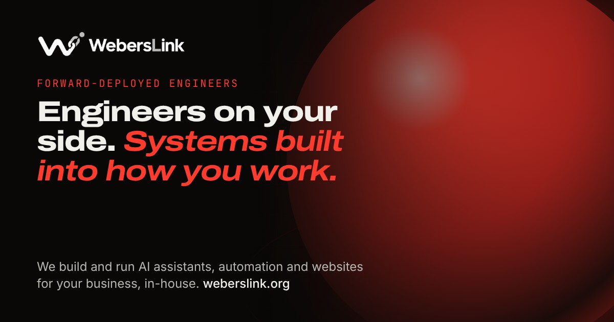

<p align="center">
  
</p>

<h1 align="center">WeberslinkClip</h1>

<p align="center">
  Record once. Post all week.<br />
  Turn long videos into short, captioned vertical clips.
</p>

---

WeberslinkClip takes a long video and finds the moments worth posting. It scores them, then renders each one as a vertical 9:16 clip with face-centered cropping, word-synced captions and a hook title, ready for YouTube Shorts, TikTok and Reels.

A product by [WebersLink](https://weberslink.org).

## What it does

- **Sources:** paste a YouTube, Twitch or Kick link, or upload a file.
- **Clip selection:** an AI model reads the transcript and picks the strongest 3–7 moments, each with a score.
- **Vertical framing:** face detection keeps the speaker centered in the 9:16 frame.
- **Captions:** word-level timestamps, caption templates, custom fonts.
- **Hook titles:** a short headline over the first seconds of each clip.
- **B-roll and transitions:** optional stock footage overlays and transition effects.
- **Editor:** trim, split and merge clips, fix a word, restyle captions, then export with TikTok, Reels or Shorts presets.
- **Publishing:** connect YouTube, TikTok or Instagram and post or schedule from the task page.

## Plans

| Plan | Price | Includes |
|---|---|---|
| **Early bird** | Free | 5 hours of video a month, 720p clips, YouTube videos up to 60 minutes |
| **Starter** | $19/month | 10 hours a month, 720p clips, custom fonts, B-roll and caption templates |
| **Studio** | $49/month | 25 hours a month, 1080p clips, priority processing, scheduled posting |

Plans are month-to-month and can be cancelled any time. The early bird allowance and the plan limits are set with environment variables; see `.env.example` (`EARLY_BIRD_*`, `*_PLAN_MINUTE_LIMIT`, `NEXT_PUBLIC_*_PRICE_*`). Set `EARLY_BIRD_ENABLED=false` to end the early bird offer.

## Setup

You need Docker, an [AssemblyAI](https://www.assemblyai.com/) API key for transcription and one LLM provider key (Google, OpenAI or Anthropic).

```bash
git clone https://github.com/AdilIshtiaq/weberslink_clipping.git
cd weberslink_clipping
cp .env.example .env
```

Add your keys to `.env`:

```env
ASSEMBLY_AI_API_KEY=your_assemblyai_api_key
LLM=google-gla:gemini-3-flash-preview
GOOGLE_API_KEY=your_google_api_key
```

Start everything:

```bash
docker-compose up -d
```

The first start takes a few minutes; follow it with `docker-compose logs -f`. Then open [http://localhost:3107](http://localhost:3107), create an account and start clipping. The API is at [http://localhost:8000](http://localhost:8000), with interactive docs at `/docs`.

Services: frontend (Next.js), backend API (FastAPI), video worker, AI-edit worker, cron worker, PostgreSQL and Redis.

## Run on your computer without Docker

See [LOCAL.md](LOCAL.md). In short: install Node, pnpm, uv, ffmpeg, PostgreSQL and Redis, then run `bash scripts/local/setup.sh` once and `bash scripts/local/run.sh` to start.

## Development

```bash
# Backend: Python 3.11+, uv, ffmpeg, PostgreSQL and Redis running
cd backend && uv sync && uvicorn src.main:app --reload --host 0.0.0.0 --port 8000
cd backend && .venv/bin/python -m src.workers.run_workers

# Frontend: Node 22 and pnpm
cd frontend && pnpm install && pnpm run dev
```

Run all tests from the repository root:

```bash
make test
```

See `CLAUDE.md` for the architecture, key files and conventions.
